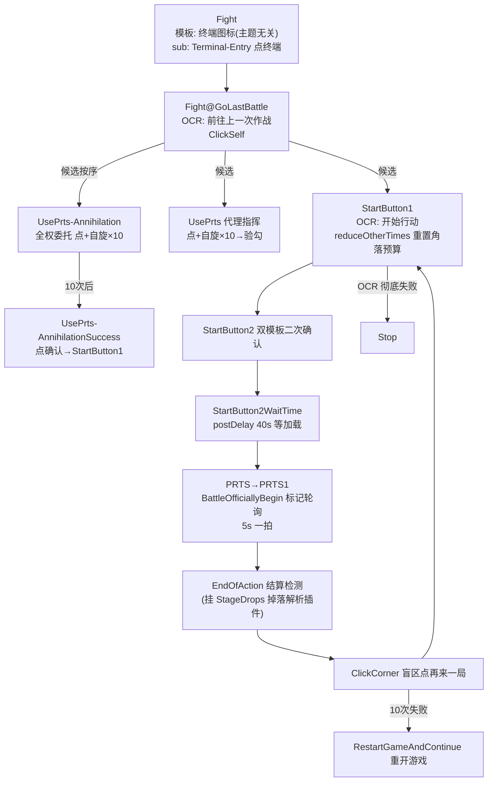

# MAA 玩法链路手册（图片 ↔ 状态 ↔ 点击 全图）

> 版本：2026-08-12，基于 MAA v6.16 资源包 869 任务 + 全部子目录（Stages/RA/Roguelike/MiniGame/UiTheme/Copilot）十四域并行解剖
> 用途：每个玩法的「识别什么 → 点哪里 → 进什么状态」完整链路，为自定义任务提供复用素材
> 配套：`docs/MAA_TASK_MECHANICS.md`（机制基础）、`tools/task_graph.py`（任意链路查询）

## 0. 总览：入口与域地图

| 玩法 | 入口任务 | 文件位置 | 核心环节 |
|------|----------|----------|----------|
| 刷关 | `FightBegin`/`StageBegin` | tasks.json | 进终端→选关→代理→进战→结算→循环 |
| 剿灭 | `Chernobog@Annihilation` 等 | tasks.json | 进剿灭→OCR 选关→全权委托→开始→结算 |
| 肉鸽 | `Roguelike@Begin` | tasks.json + Roguelike/ | 选主题→开局→地图寻路→战斗→结算→下局 |
| 生息演算 | `Reclamation2`（C++ 入口） | RA/ 目录 | 建档→建设委托→采集制造→跳天→删档循环 |
| 基建 | `InfrastBegin` | tasks.json | 进基建→各设施→干员换班→确认 |
| 公招 | `Recruit` | tasks.json | 进公招→OCR 标签→选组合→招募→确认 |
| 启动 | `StartUpBegin` | tasks.json | 启动→分诊→进主界面→确认稳定 |
| 领取 | `AwardBegin`/`MailBegin` | tasks.json | 领奖励→关弹窗→验领完 |
| 商店/抽卡 | `Store@Begin`/`GachaOnce`（C++ 入口） | tasks.json | 领信用→选购→确认到账 / 抽卡→跳过→结算 |
| 活动关卡 | `AD-8` 等（关卡名即任务名） | Stages/ | 进活动→OCR 关卡名→进关 |
| 抄作业 | `Copilot@X` 覆盖 | tasks.json + Copilot/ | 找关→播放→等结算（覆盖同名任务） |
| 小游戏 | `MiniGame@活动@...` | MiniGame/ | 各自独立点按状态机 |

**通用模式**：所有入口都是 `JustReturn` 扇出（不识别、next 列表即"当前可能出现的画面"优先级表），由识别器决定走哪支；每步带 `maxTimes/exceededNext` 兜底 + `postDelay` 等动画。

---

## 1. 刷关主链（Fight）



**关键环节表**：

| 环节 | 识别 | 动作 | 状态 |
|------|------|------|------|
| 主界面锚点 | 设置齿轮图标（主题无关） | DoNothing + sub 点终端 | 终端页 |
| 进终端 | 16 套主题 Terminal 模板 | ClickSelf | 终端 |
| 快捷进终端 | 小房子菜单 QuickSwitch | 点终端图标 | 终端 |
| 已在终端 | `StageResource.png` 资源关卡图标 | Stop | 终止 |
| 关卡确认页 | OCR 前往上一次作战 | ClickSelf | 确认页 |
| 理智分支 | UseMedicine/UseStone/NoStone 三模板 | 点击用药/碎石/关页 | 回 StartButton1 |
| 战斗中 | PRTS1 顶角标记（maskRange 滤浅色） | 5s 轮询 | 战斗中 |
| 结算 | EndOfAction ROI | 检测 | 结算页 |
| 循环 | 盲区 [1000,20,270,50] | 点再来一局 | 回确认页 |

**兜底链**：点击失败 → `#self` 自旋 → maxTimes → `exceededNext` 换策略（代理验勾/重开游戏）→ OCR 失败 → `StageSNReturnFlag` 点左上角 → Stop。跨轮预算用 `reduceOtherTimes "(ClickCornerAfterPRTS+ClickCorner)*10"` 每轮充值 10 次，防止失败次数跨轮累积。

---

## 2. 剿灭链（Annihilation）

**核心机制：关卡名即任务名**——`stage="Chernobog@Annihilation"` 执行同名任务，`@` 前缀把通用导航变成"点切尔诺伯格"。

```
进剿灭列表(模板 StageAnnihilation 0.9) → 返回箭头(Return 0.7)
  → OCR"切换"(966,577) 打开切关菜单
  → OCR 关卡名: 切尔诺伯格/龙门外环/龙门市区 (同 ROI 721,22,529,693, 只差 text)
  → FightBegin → UsePrts-Annihilation(点全权委托 877,532,183,123, #self×10)
  → UsePrts-AnnihilationSuccess(点确认 938,527,156,133) → StartButton1 开始
  → 战斗 → EndOfActionAnnihilation(ROI 50,50,170,180) → ClickCorner 循环
  → 剿灭专属: AnnihilationConfirm 开局确认(992,584) / AnnihilationPrtsRecordConfirm 周记录(600,630)
```

**三关区分 = 纯 OCR 文字，不用模板**（`Chernobog@AnnihilationStage` 只覆写 `text:["切尔诺伯格"]`，未来新增剿灭关零改动）。

**外部判定分工**（MAAOrch）：MAA 内部链负责导航+操作；`stage_probe.py` 外部截图判定"能不能刷"——`PRTS_ROI (876,532,183,123)` 与 MAA 内部点击 ROI `[877,532,183,123]` 逐像素同源，模板同源（`UsePrts-AnnihilationSuccess.png`）但阈值降到 0.4（MAA 内部 0.7），加金色占比详情页判定。

---

## 3. 肉鸽链（Roguelike）

**状态中枢模式**：`Roguelike@Begin`（JustReturn）把整局所有可能画面排进 next，谁命中走谁；全局兜底 `onErrorNext: ExitThenAbandon`。

```
Roguelike(主界面锚点) → @TodoEnter → @IntegratedStrategies(点开集成战略)
  → @PreSelectTheme(OCR"查看") → @SelectTheme(OCR 主题横条, maxTimes 20 自旋)
    各主题 text: Phantom 古堡笔记 / Mizuki 生态谱系 / Sami 科考记录 / Sarkaz 假说辑录 / JieGarden 游园纪念
  → @Begin(状态中枢)
  → @StartExplore(开始探索, 挂难度选择插件)
  → @Squad-EnterPoint(分队) → @RolesDefault(角色组合) → @RecruitMain(首干员)
  → @Stages(层内节点分发, 按策略模式 _default/_aggressive/_pragmatic/_fastInvestment 变体)
  → StageXxxEnter(进节点) → @QuickFormation(编队) → @StartAction(开始行动, 挂技能/战斗插件)
  → @InBattleFlag(BattleOfficiallyBegin) → @MissionCompletedFlag / @MissionFailedFlag(胜负)
  → @GetDrops(掉落: 拿走/翻开/不要了) → @GamePass(结算, 挂 settlement 插件截图)
  → GamePassSkip1/2(跳过动画) → @ClickToStartPoint(回起点) → @StartExplore 下一局
中途放弃: @ExitThenAbandon → @Abandon → AbandonConfirm
投资模式: 商店 @StageTraderInvestConfirm(自动投资) → 储备达上限 → 退出结束
```

**主题差异 = 前缀覆盖**：`Sarkaz@Roguelike@X` 覆盖同名公共任务，只写差异字段。新主题大量用 `HSVCount/RGBCount` 色域替代模板图（`Sarkaz@Roguelike@StageCombatOps` 用色带 [127,80,50]-[136,200,180]），免维护 UI 改版模板。

**寻路插件**：`routing.json` 的 `RoguelikeRoutingConfig` 用 9 个 specialParams 描述地图网格几何，节点识别靠"彩色+灰色"成对模板（彩色=可走，灰=不可走）；`StrategyChange` 用 ocrReplace 把层名映射成 `_default/_exit/_SKIP_` 伪文本实现"烧水在第 2 层退出"等策略。

---

## 4. 生息演算链（RA）

**独立域**：tasks.json 不含 RA 任务，全在 `RA/` 子目录，由 `ReclamationTask`（C++ 插件）按 `gui.new.json` 配置驱动（MAAOrch 注入 `Theme/Mode/ToolToCraft` 等）。

```
入口: Reclamation2(JustReturn, 扇出所有分支) → Begin/BeginContinue/DeleteArchive
模式 A: PIS 存档刷点数: PIS-Commence → PIS-Workbench → PIS-CraftTool(刷荧光棒)
       → PIS-SkipToCalc(跳量定结算) → 繁荣度未达上限 → LoadSave 读档循环; 达上限 → 商店清仓
模式 B: 建设委托(RA-1/RA-4/RA-15, 三日委托各 40 步):
       RA1-Prepare(OCR"RA-1") → OpenConstruction(OCR"开启建设") → ChooseStrategy → StartConstruction
       → SkipPlot → DeployGatheringBaseSwipe(滑=占位部署) → Cost(OCR 费用≥22 门控)
       → DeployOperatorSwipe/Direction(部署干员) → MissionIcon1(模板任务图标)
       → DeliverWood5(交木材) → ManufactureIcon → Infrastructure → StartBuildingStation
       → ExitConstruction → CraftOwnCommStation → DeliverStone10 → SettleNow(立即结算)
       → FinishConstruction → 回到 Prepare 循环
```

**特点**：部署不靠图像识别，全靠"占位 Swipe"（从槽位滑到地图坐标）；OCR 门控（`22+`/`READY`/`1/1` 用正则归一）；每个任务带 `doc: "步骤 N：..."` 把游戏流程逐拍编号（JSON 可读作攻略）；模式互斥哨兵（PIS/PNS 互相识别对方入口文字 DoNothing 提示切模式）。

---

## 5. 基建链（Infrast）

**7 类设施全覆盖**（制造/贸易/发电/宿舍/会客室/办公室/训练室），每设施一对"全尺寸 + Mini"模板识别器（`maskRange:[1,255]` 排除透明像素），`templThreshold 0.9-0.95`。

```
InfrastBegin(七路探测) → Infrast(主界面锚点 + sub: Infrast-Entry)
  → InfrastEnteredFlag(InfrastOverview.png 判定已进)
  → 一键收获: InfrastNotification → InfrastReward(OCR, 防误点一键换班)
  → 设施操作(以制造站为例):
    InfrastMfgMini(卡片) → ClickSelf → InfrastFacilityListTabMfg(左栏tab)
    → InfrastEnterFacility(等动画) → InfrastStationedInfo(OCR"进驻信息")
    → InfrastEnterOperList(OCR"心情/休息中/工作中/进驻") → 干员列表
    → InfrastOperFace(笑脸锚点) → 各识别全用 rectMove 相对笑脸偏移
      (名字 OCR / 所在设施 OCR / 心情进度条灰度 / 在岗标记 OnShift.png)
    → InfrastOperSelected(HSVCount 绿色色域判选中)
    → 排序/筛选/清空 → InfrastConfirmButton(ClickRect 提交)
    → InfrastConfirmButtonWait(OCR"正在提交"自旋) → Stop
宿舍有双确认: DormConfirmButton → DormDoubleConfirmButton
无人机: DroneAssistMfg(一次性全用) / DroneAssistTrade(逐单, 无订单=耗尽 Stop)
线索: InfrastClue → ClueVacancy1-7(空位可放) / ClueNo1-7(不可放) → SendClues → SelectClue(RGB 色)
```

**换班决策在 C++**（读 `infrast.json` 技能数据库做最优分配），JSON 只提供识别原语；排班方案由 `custom_infrast/*.json` 用户文件定义；MAAOrch 通过白名单字段注入 facilities/drones/dorm_threshold。

---

## 6. 公招链（Recruit）

```
Recruit(主界面锚点 + sub: Recruit-Entry 主题指纹分发 16 套模板)
  → RecruitBegin(状态轮询: 停止条件在前/兜底在后)
  → RecruitFlag(OCR"公开招募" → Stop, 核心层接管)
  → C++ 层: OCR 标签 → 查 recruitment.json 组合 → 决策
  → StartRecruit(OCR"开始招") → RecruitTimerH/M(校验 9 小时计时, isAscii+withoutDet)
  → RecruitNow(OCR"立即招"加速) → RecruitNowConfirm(弹窗确认)
  → RecruitRefresh(刷新券) → RecruitRefreshConfirm → SleepThenStop(静默退出)
  → RecruitConfirm(结果确认, postDelay 500 防误点"放弃招募")
  → RecruitFinish → RecruitSkip(右上角) / RecruitSkipWithoutButton(盲点兜底 maxTimes 10)
  → RecruitContinue(OCR"继续招") → 循环
```

**标签识别**：`RecruitTags` 用 `text:[] + fullMatch:true`（只 OCR 不匹配，纯采集 5 个标签文字），`ocrReplace` 专攻稀有标签（`.*高级.+→高级资深干员`、`^资深.+→资深干员`）；星级判定 = OCR 文字 + `recruitment.json` 数据表查稀有度（`select:[4]` 只选必出 4 星以上组合），不是图像识别。

---

## 7. 启动链（StartUp）

```
StartUpBegin(JustReturn 分诊) → StartUp@StartUpThemes#next(12 路状态分诊台)
  各状态识别:
  - GameStart(开始游戏按钮, 模板 0.7) → @LoadingIcon
  - StartToWakeUp(开始唤醒, ClickSelf) / StartToWakeUpOCR(OCR 兜底)
  - StartLoginBServer(B 服登录) / BiliBiliNoMorePromptsNextTime / LeidianGoogleFrameworkConfirm
  - StartUpConnectingFlag(连接中横幅) → GameStartCheckResourceOCR / GameStartUpdateOCR(等更新下载)
  → MainThemes#next(已到主界面标记) → StartUp(模板锚点反复确认 ×3, "停一小会又弹窗"防呆)
  → 完成
账号切换: SwitchAccount@StartUpBegin 接管 → SwitchAccount@StartToWakeUp(DoNothing 干掉点击登录)
  → AccountManager(右下账号按钮) → LoginOther → AccountManagerOfficial(模板)/AccountManagerBili(OCR, dpi 缩放不能模板)
  → AccountManagerListAccount(点上次登录) → AccountManagerLoginButton(OCR"登录") → AccountCurrentOCR(读当前账号)
```

**进主界面判据**：`MainThemes` 是 `JustReturn + next:["#back"]` 的纯标记任务；`StartUp` 用 `maxTimes:3 + postDelay:1000` 连续三次确认仍在主界面才放行（弹窗防呆）。

---

## 8. 领取 / 商店 / 抽卡链

**领取**：
```
AwardBegin(探测: 直接领→每日→每周→主界面→返回→关公告)
  → ReceiveAward(右上领取) → CloseTaskAward(结算弹窗关闭, maxTimes 10 多点一次)
  → DailyTask/WeeklyTask(顶栏 tab, rectMove 左移 150px 复用模板)
  → AwardFinished(HSVCount 检测顶栏红点消失 → Stop)
活动折叠: AwardExpandCheckFlow(幸运墙/限时开采/月卡>3 个会折叠 → 展开再领)
邮件: MailBegin → ReceiveMail(右下) → ReceivedAllMail(HSVCount [250,255] 红点消失)
```

**商店**：
```
Store@Begin → EnterStore(模板 Mall 图标) / EnterTicketStore(OCR"凭证交易所")
  → 绿票: OCR"资质凭证区" → 一层: ClickFirstFloor(OCR"1/T/I") → ClickItemList
    → ClickItem_*(FeatureMatch 物品图标, BRISK) → ChooseMaxAmount(OCR"最多")
    → UnderfundedOCR(余额检查) → Purchase(OCR"购买物品") → PurchasedConfirm
  → 二层: SecondFloor-Check(HSVCount 检测红色入口)
信用商店: CreditShop-BuyIt(模板) → CreditShop-Bought(模板匹配到账图标, ClickRect 固定按钮底)
  → CreditShop-NoMoney(OCR"信用不足") 失败分支
兑换: ChangeProductTo*(模板) → ChooseTab → ClickProductMax → ConfirmProductChange(模板验证) → ProductFinalConfirm
```

**抽卡**：
```
GachaOnce/GachaTenTimes(C++ 入口) → Gacha(主题分发 15 套) → DoGacha(OCR"寻访一次/十次")
  → GachaConfirm(盲点确认) → GachaWaitingForBag → GachaSwipeToOpenBag(右滑×20) → GachaSkip(连点跳过)
  → GachaLastOnceResult(OCR"凭证/信物/获得") → GachaBegin#next 循环
  → GachaNoMoney(缺钱 Stop)
```

**理智药**（C++ MedicineCounter 插件绑定）：`UsingMedicine-Target/SanityMax/Count/Inventory/ExpiringTime` 五个 OCR 任务（全继承 `NumberOcrReplace` 数字归一基座）读理智/上限/库存/到期，插件算差几瓶；`MedicineExpiringTime` 把"3天→3、X小时→0"用于过期优先级。

---

## 9. 活动关卡导航链（Stages）

**一个活动一个 json、结束即删**——加载序：tasks.json → Stages/ 子目录按文件名覆盖；活动任务名全部以活动代码命名空间隔离（AD-/TO-/HS-…），删文件=整体卸载。

```
AD-8(关卡名即任务, JustReturn)
  → sub: AD-8@AD-OpenOpt(进活动页双保险)
      AD-8@AD-OpenOcr(OCR banner 文字"红丝绒/为戏剧/为永恒" 点击) 
      / AD-8@AD-Open(模板 StageSideStory/StageActivity 点击)
  → AD-8@ADChapterToAD(OCR"演出开始"点活动章节入口, #self 重试)
  → AD-8@SideStoryStage(OCR"AD-8" 点击; @ 前缀把通用任务变成"点 AD-8")
  → AD-8@SwipeToStage(左滑兜底) → 找不到 → 回首页
  → 链结束 → FightBegin 接棒点开始行动
```

**活动 json 只写三处差异**：banner 文字、章节按钮文字、关卡名（可任意覆写 text/roi——关卡码与关卡名解耦，如 AveMujica-3 → 游戏内 `SS-3`）；base.json 提供永久组件（SS-Open/SS-OpenOcr/SideStoryStage/SwipeToStage/SS@Store）。

**OCR 抗噪工程**：中文活动标题拆成完整串 + 全部 2 字连续子串（"太阳/阳甩/甩在/在身/身后" 18 个候选，任何相邻两字识别正确即命中）；纠错表 4 张（EpisodeOcrReplace/ClickStageName/ClickedCorrectStage/SideStoryStage），`g→8`、`-]→-1`、`(H\d+)O(?=-)→${1}0` 等把关卡码识别命中率做到工程可用——**改表不改模型**。

---

## 10. 通用组件（横切能力）

| 组件 | 机制 | 用法 |
|------|------|------|
| 等待加载 | `LoadingIcon`（黑色三角模板）/`LoadingText`（OCR"正在提交"）自环 + `#next/#back` 放行 | `任意任务@LoadingIcon` 虚派生挂载 |
| 返回 | `ReturnButton`（Return.png 双模板，链式清弹窗）/`ReturnButtons` 枢纽（分流 FromStageSN/FromAnnihilation 无箭头关卡） | `X@ReturnButtons#next` |
| 关公告 | `CloseAnnoBase`（empty.png 盲点）+ 三变体 roi（普通 1100,0 / Texas 1125,24 / SpecialAccess 998,87）递归到没有为止 | `X@CloseAnnos#next` |
| 掉线 | `OfflineConfirm`（PopupConfirm 模板 + reduceOtherTimes 防误点开始按钮） | 全域共享 |
| 滑页 | `SlowlySwipeToTheLeft/Right/Up/Down`（specialParams 平滑曲线, maxTimes 50） | `baseTask` 继承只改起终点 |
| 切页 | `QuickSwitch@ToHome/Terminal/Infrast/...`（小房子下拉菜单） | `X@QuickSwitch@ToX#next` |
| 重开游戏 | `RestartGameAndContinue`（终极兜底） | 结算循环卡死时 |
| 主界面锚点 | `SwitchTheme@ToggleSettingsMenu.png` 设置齿轮（主题无关） | 所有域的入口确认 |

**等待机制三层**：识别自环（无限等，图标消失即放行）→ 文字层（OCR 消失 + 2000ms 消抖）→ 纯延时兜底（postDelay 40000）。

---

## 11. 核心设计模式汇总（自定义任务直接套用）

1. **入口扇出**：`JustReturn` + next 列表 = 当前所有可能画面的优先级表，识别器决定走哪支
2. **状态中枢**：`Roguelike@Begin`/`StartUpThemes` 型——做完事 `X#next` 跳回中枢重新分诊
3. **@ 上下文传播**：`X@Y` 列表字段自动加前缀，一套逻辑复用 N 场景（每关只加一条 text）
4. **Check 断言任务**：`template + DoNothing + next:[]` 纯状态探针，命中即终止/分流
5. **无模板必中节点**：`ClickSelf` 无 template = 无条件点击步骤，配 `#self`+`maxTimes`+`exceededNext` 保险丝
6. **reduceOtherTimes 预算**：跨轮计数充值/抑制，防失败次数跨轮累积误触兜底
7. **空模板占位**：`empty.png` = 盲点/状态检测器，templThreshold/specialParams 可重载为灰度/间距阈值（`*_Doc` 注释说明）
8. **OCR 基座继承**：NumberOcrReplace（数字 13 规则，被 13 任务继承）/CharsNameOcrReplace（干员名 71 规则）单点维护
9. **`_INVALID_` 拒绝哨兵**：正则把垃圾识别结果映射到永不匹配串，实现 OCR 白名单
10. **主题三层覆盖**：文件加载序 → 服务器语言目录（global/xx）→ 运行时上下文（Copilot@X），改行为不改调用方
11. **颜色识别**：RGBCount/HSVCount/Ccoeff 配窄色带（状态色/高亮色），免维护模板图；`baseTask + method 覆盖` 零逻辑切换算法
12. **插件挂载点**：Doc 字段声明"本任务注册了 XxxTaskPlugin"，JSON 只管何时触发，决策在 C++——任务域与代码域解耦
