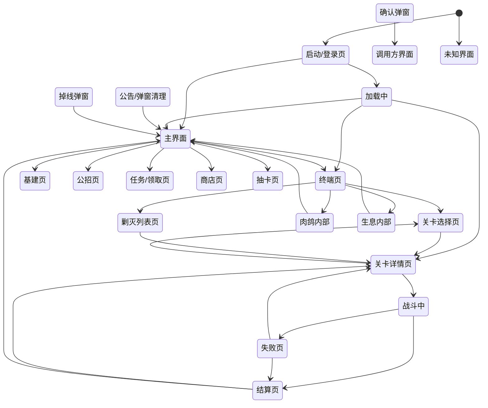

# MAA 游戏语义状态图（MAA 隐式状态机的显式化）

> 2026-08-12 从 14 域任务解剖提炼 — MAA 不知道自己在哪个界面，
> 但它的每个识别条件就是一条状态定义。这张图把它不自知的认知显式化。

## 状态清单

### 启动/登录页
游戏启动到进入主界面前的所有界面（开始游戏按钮/开始唤醒/B服登录/连接中）

| 信号类型 | 内容 | 位置 |
|----------|------|------|
| 模板 | `GameStart 区域 550,600` | 游戏标题区 |
| OCR | `开始唤醒/登录` | 中上部 |
| 结构 | `StartUpThemes 分诊台命中任一` | 全屏 |

关联任务（7）: `StartUpBegin`, `StartUpThemes`, `GameStart`, `StartToWakeUp`, `StartToWakeUpOCR`, `StartLoginBServer`, `StartUpConnectingFlag`
转移: 加载中 → 主界面

### 加载中
黑屏/转场加载（黑色正三角图标或'正在提交'文字）

| 信号类型 | 内容 | 位置 |
|----------|------|------|
| 模板 | `LoadingIcon（480,210,320,280）` | 中央 |
| OCR | `正在提交/反馈至神经` | 下方 700,600 |

关联任务（4）: `LoadingIcon`, `LoadingText`, `LoadingTextPostDelay`, `StartButton2WaitTime`
转移: 任意目标界面

### 公告/弹窗清理
启动/切页后的公告、今日配给、语音下载等弹窗

| 信号类型 | 内容 | 位置 |
|----------|------|------|
| 结构 | `CloseAnnos 分诊台命中` | 全屏 |
| 模板 | `CloseAnno 系列 ROI（1100,0 等）` | 右上 |

关联任务（6）: `CloseAnnos`, `CloseAnno`, `CloseAnnoTexas`, `CloseAnnoSpecialAccess`, `TodaysSupplies`, `NotDownloadVoice`
转移: 主界面 → 调用方界面

### 主界面
游戏大厅——所有玩法的共同入口锚点

| 信号类型 | 内容 | 位置 |
|----------|------|------|
| 模板 | `SwitchTheme@ToggleSettingsMenu.png（227,327,159,152）` | 左中 |
| 结构 | `9 个入口页共享此锚点（Fight/Recruit/Infrast/Award…）` | 全屏 |

关联任务（9）: `Fight`, `StartUp`, `Recruit`, `Infrast`, `Award`, `Mall`, `Gacha`, `OperBox`, `Visit`
转移: 终端页 → 基建页 → 公招页 → 任务页 → 商店页 → 抽卡页

### 终端页
终端主界面（16 套主题，主题无关锚点触发后转发）

| 信号类型 | 内容 | 位置 |
|----------|------|------|
| 模板 | `Terminal-Entry 16 主题之一命中` | 右上 844,58 |

关联任务（5）: `Terminal-Entry`, `TerminalDefault`, `TerminalDark`, `GoLastBattle`, `GoTerminalStopflag`
转移: 关卡选择页 → 剿灭列表页 → 肉鸽内部 → 生息内部

### 关卡选择页
主线/活动关卡列表（OCR 关卡名导航）

| 信号类型 | 内容 | 位置 |
|----------|------|------|
| OCR | `关卡名（ClickStageName/SideStoryStage 全屏 roi）` | 全屏 0,60 |
| 结构 | `FullStageNavigation 滑动找关` | 全屏 |

关联任务（6）: `ClickStageName`, `SideStoryStage`, `SwipeToStage`, `ClickedCorrectStage`, `FullStageNavigation`, `ChapterSlowlySwipeToTheLeft`
转移: 关卡详情页

### 关卡详情页
点关卡后的确认页（代理/全权委托/开始行动按钮区）

| 信号类型 | 内容 | 位置 |
|----------|------|------|
| 模板 | `UsePrts-Annihilation（877,532,183,123）` | 右中 |
| OCR | `开始行动/开始作战/开始推演（1010,625）` | 右下 |
| 颜色 | `开始行动按钮金色占比 > 0.10` | 右下 1090,620 |

关联任务（8）: `UsePrts-Annihilation`, `UsePrts`, `UsePrts-StageSN`, `NotUsePrts`, `StartButton1`, `UseMedicine`, `UseStone`, `AnnihilationConfirm`
转移: 战斗中 → 关卡选择页

### 战斗中
战斗进行中（顶角标记出现，5s 轮询）

| 信号类型 | 内容 | 位置 |
|----------|------|------|
| 模板 | `BattleOfficiallyBegin（1165,20,75,65, maskRange 滤浅色）` | 右上顶角 |

关联任务（8）: `PRTS`, `PRTS1`, `PRTS2`, `PRTS3`, `WaitAfterPRTS`, `BattleOfficiallyBegin`, `BattleStart`, `BattlePauseCancelCheck`
转移: 结算页 → 失败页

### 结算页
战斗结束结算（掉落解析插件挂载点）

| 信号类型 | 内容 | 位置 |
|----------|------|------|
| 模板 | `EndOfAction（0,290,70,60）` | 左上 |
| 结构 | `ClickCorner 盲区点击再来一局` | 右上 |

关联任务（5）: `EndOfAction`, `EndOfActionAnnihilation`, `ClickCorner`, `ClickCornerAfterPRTS`, `CheckLevelUp`
转移: 关卡详情页 → 主界面

### 失败页
任务失败（3 连败停止/降级换关）

| 信号类型 | 内容 | 位置 |
|----------|------|------|
| OCR | `任务失败（36,226,482,269）` | 左中 |

关联任务（4）: `FightMissionFailed`, `FightMissionFailedAndStop`, `PrtsErrorConfirm`, `AbandonAction`
转移: 结算页 → 关卡详情页

### 掉线弹窗
网络断线重连确认

| 信号类型 | 内容 | 位置 |
|----------|------|------|
| 模板 | `OfflineConfirm（PopupConfirm 630,400,650,160）` | 中央 |

关联任务（3）: `OfflineConfirm`, `OfflineConfirmImpl`, `OfflineConfirmAfterBattle`
转移: 主界面 → 调用方界面

### 确认弹窗
通用二次确认（返回确认/刷新确认/公招加速确认共享同一模板）

| 信号类型 | 内容 | 位置 |
|----------|------|------|
| 模板 | `PopupConfirm（630,400,650,160）` | 中央 |

关联任务（6）: `ReturnConfirm`, `RecruitRefreshConfirm`, `RecruitNowConfirm`, `MedicineConfirm`, `StoneConfirm`, `GachaConfirm`
转移: 调用方界面

### 剿灭列表页
剿灭关卡选择（切关菜单 + OCR 三关名）

| 信号类型 | 内容 | 位置 |
|----------|------|------|
| 模板 | `StageAnnihilation（900,70,380,400, 0.9）` | 右上 ToDoList |
| OCR | `切换（966,577）/切尔诺伯格/龙门外环/龙门市区` | 右下/中部 |

关联任务（5）: `Annihilation`, `Chernobog@Annihilation`, `AnnihilationSwitchButton`, `Chernobog@AnnihilationStage`, `AnnihilationReturn`
转移: 关卡详情页

### 基建页
基建总览/设施内页

| 信号类型 | 内容 | 位置 |
|----------|------|------|
| 模板 | `InfrastOverview（0,100,300,150, 0.95）` | 左上 |
| 模板 | `设施卡片 Mini 模板（Mfg/Trade/Dorm…）` | 中部 |

关联任务（7）: `InfrastBegin`, `InfrastEnteredFlag`, `InfrastMfg`, `InfrastMfgMini`, `InfrastEnterOperList`, `InfrastConfirmButton`, `InfrastDormConfirmButton`
转移: 主界面

### 公招页
公开招募界面（标签 OCR + 招募按钮）

| 信号类型 | 内容 | 位置 |
|----------|------|------|
| OCR | `公开招募（50,100,230,100）` | 左上 |
| OCR | `开始招（0,300,1280,420）` | 中下 |

关联任务（7）: `Recruit`, `RecruitBegin`, `RecruitFlag`, `RecruitTags`, `StartRecruit`, `RecruitNow`, `RecruitConfirm`
转移: 主界面

### 任务/领取页
每日/每周任务奖励领取

| 信号类型 | 内容 | 位置 |
|----------|------|------|
| 模板 | `ReceiveAward（950,50,330,150, 金 0.79）` | 右上 |
| 颜色 | `AwardFinished 顶栏红点消失（HSVCount）` | 顶部 |

关联任务（8）: `AwardBegin`, `ReceiveAward`, `CloseTaskAward`, `DailyTask`, `WeeklyTask`, `AwardFinished`, `MailBegin`, `ReceiveMail`
转移: 主界面

### 商店页
信用/绿票/黄票商店

| 信号类型 | 内容 | 位置 |
|----------|------|------|
| OCR | `信用交易所/资质凭证区/高级凭证区` | 顶部 |
| 结构 | `Store@Begin 分诊` | 全屏 |

关联任务（7）: `Store@Begin`, `CreditStoreOcr`, `CollectCredit`, `CreditShop-BuyIt`, `ChooseMaxAmount`, `Purchase`, `UnderfundedOCR`
转移: 主界面

### 抽卡页
寻访界面

| 信号类型 | 内容 | 位置 |
|----------|------|------|
| OCR | `寻访一次/十次（779,576,248,141）` | 右下 |
| 模板 | `Gacha-Entry 15 主题之一` | 入口 |

关联任务（6）: `Gacha`, `Gacha-Entry`, `DoGacha`, `GachaConfirm`, `GachaSkip`, `GachaSwipeToOpenBag`
转移: 主界面

### 肉鸽内部
集成战略整局（主题选择/节点/战斗/结算，状态中枢分诊）

| 信号类型 | 内容 | 位置 |
|----------|------|------|
| 结构 | `Roguelike@Begin 分诊命中任一` | 全屏 |

关联任务（5）: `Roguelike@Begin`, `Roguelike@SelectTheme`, `Roguelike@StartExplore`, `Roguelike@Stages`, `Roguelike@GamePass`
转移: 主界面

### 生息内部
生息演算整局（建设/采集/跳天，C++ 入口）

| 信号类型 | 内容 | 位置 |
|----------|------|------|
| 结构 | `Reclamation2 分诊命中任一` | 全屏 |

关联任务（3）: `Reclamation2`, `RA1-Prepare`, `Tales@RA@PIS-Commence`
转移: 主界面

### 未知界面
没有任何已知信号命中——MAA 会死磕兜底链，我们应该停下记录

| 信号类型 | 内容 | 位置 |
|----------|------|------|
| 结构 | `全部状态信号不命中` | 全屏 |

## 转移关系

## 关键认识

1. **MAA 的认知 = 一组识别信号**：命中什么模板/OCR = 在什么界面，仅此而已
2. **状态转移 = next 链**：识别信号 → 动作 → 下一组信号，MAA 不自知地在状态机里走
3. **未知界面是 MAA 的盲区**：它只会死磕兜底链（重开游戏）；我们应该停下记录报警
4. **画面理解工具基于此表**：截图 → 逐状态验证信号 → 输出状态+证据