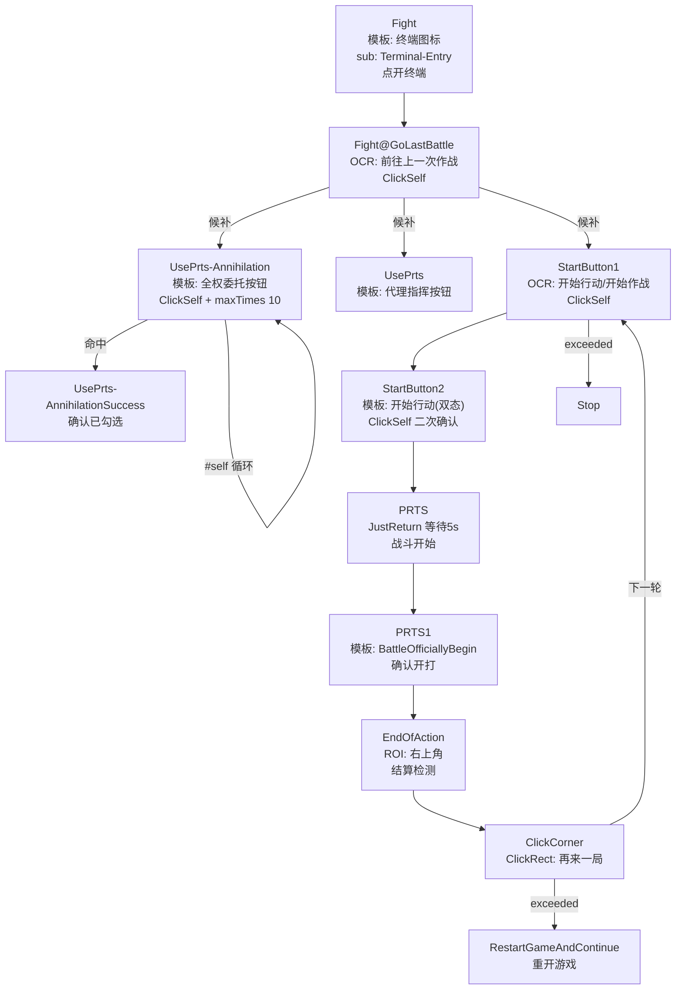

# MAA 任务机制手册（图片识别 ↔ 状态转移 ↔ 点击动作）

> 版本：基于 MAA v6.16 自带 `resource/tasks/tasks.json`（869 个任务定义）实测解剖
> 用途：搞懂 MAA 任务引擎的完整逻辑链，为**自己定义自定义任务**打基础
> 配套工具：`tools/task_graph.py`（任务转移图）、`tools/vision_translate.py`（图片转译）、`services/task_explainer.py`（DeepSeek 逻辑问答）

## 1. 一句话模型

MAA 的任务引擎是一个**识别-动作状态机**：

```
循环: 识别画面 → 命中条件(模板图/文字/颜色) → 执行动作(点击/滑动) → 跳转到 next 候选任务
```

每个"任务"就是状态机的一个状态：**识别什么 → 做什么 → 去哪**。869 个任务串成整张游戏操作图。

## 2. 任务文件与加载

| 文件 | 内容 |
|------|------|
| `resource/tasks/tasks.json` | 869 个核心任务定义 |
| `resource/tasks/Stages/*.json` | 活动关卡导航（44 个文件 + base.json），一个关卡一个 json |
| `resource/tasks/UiTheme/*.json` | 主题终端（按 UI 主题覆盖同名任务） |
| `resource/tasks/RA/` `Roguelike/` `MiniGame/` `Copilot/` | 生息/肉鸽/小游戏/抄作业 专属任务 |
| `resource/template/` | 2147 张 PNG 模板图（匹配锚点） |
| `resource/config.json` | 全局参数（`taskDelay:500` 识别间隔、`controlDelayRange` 点击随机延时） |

**加载顺序**：`tasks.json` 先加载，后续文件**按名字覆盖**同名任务——这就是"活动结束即删 json"的扩展模式。

## 3. 识别算法（怎么"看"画面）

| algorithm | 数量 | 识别什么 | 关键字段 |
|-----------|------|----------|----------|
| （缺省） | 631 | 模板图匹配（template 缺省 = `任务名.png`） | `template`（可列表=多模板任一命中）、`templThreshold`（默认 0.7）、`maskRange`（灰度掩码） |
| `OcrDetect` | 122 | 文字 | `text`（列表，任一命中）、`fullMatch`、`ocrReplace`（纠错）、`isAscii` |
| `JustReturn` | 112 | **不识别**，直接执行动作 | 仅 `action` + `next` |
| `FeatureMatch` | 3 | 特征点（BRISK/SIFT） | `template`、`count`、`detector` |

识别命中的前提是识别区域在 `roi`（Region of Interest，`[x,y,w,h]`）内。`roi` 是 1280×720 基准坐标，运行时等比缩放到实际分辨率。

## 4. 动作体系（识别到后"做什么"）

| action | 数量 | 含义 |
|--------|------|------|
| `ClickSelf` | 239 | 点击识别命中区域的**随机点**（带 `controlDelayRange` 随机延时防封） |
| `ClickRect` | 48 | 点击 `specificRect` 指定区域 |
| `DoNothing` | 40 | 只识别不动作（缺省动作，用于纯状态探测） |
| `Swipe` | 11 | 滑动：`specificRect` 起点 → `rectMove` 终点，`specialParams` 控制时长/曲线 |
| `Stop` | 10 | 停止当前任务序列 |

滑动任务示例（`SlowlySwipeToTheLeft`）：

```json
{
  "algorithm": "JustReturn",
  "action": "Swipe",
  "postDelay": 200,
  "specificRect": [300, 310, 100, 100],   // 起点
  "rectMove": [880, 310, 100, 100],       // 终点
  "specialParams": [200, 1, 2, 0],        // [时长ms, 额外滑动, slope in, slope out]
  "next": ["#next"],
  "maxTimes": 50
}
```

## 5. 状态转移（图片与图片之间的逻辑）

这是"图片 A → 动作 → 图片 B"的核心：

```
命中识别条件 → 执行 action → 执行 sub（子任务） → 跳 next 列表
未命中 → 循环识别（间隔 preDelay）→ 达到 maxTimes 次 → 跳 exceededNext
识别出错 → 跳 onErrorNext
```

**`next` 是候选列表，从左到右逐个尝试**：第一个命中的任务被执行，然后跟着它自己的 next 继续。整张任务图就是靠这个展开的。

### 5.1 next 特殊值

| 值 | 含义 |
|----|------|
| `#self` | 重试当前任务（配合 maxTimes/exceededNext 构成"点不到就换策略"） |
| `#next` | 沿用上一任务的 next 列表 |
| `#back` | 回退到上一任务 |
| `A#next` / `A#back` | 取任务 A 的 next/back 作为跳转目标 |

### 5.2 兜底机制（失败怎么走）

- `maxTimes`（65 个任务）：最多识别 N 次，超了跳 `exceededNext`（43 个任务有）
- `exceededNext`：点不到就换策略（如 `ClickCorner` 超时 → `RestartGameAndContinue` 重开游戏）
- `onErrorNext`：识别异常（截图失败/OCR 报错）时的退路

## 6. 继承机制（`baseTask` + `B@A`，94 个 @ 任务）

MAA 用**任务名前缀**传播上下文，这是理解任务图的关键：

- **`baseTask` 字段**：显式继承，未覆写的字段取基任务默认值
- **`B@A` 命名**：名字带 `@` 的任务继承 `A` 的定义（算法/参数），列表字段自动加 `B@` 前缀继续传播
- **隐式继承**：`next` 里引用 `B@A` 但未定义 → 等同 A 的定义

典型用法——刷关入口（`FightBegin` 的官方注释）：

```json
"FightBegin": {
  "Docs": "Fight@前缀保证各种任务的Main可以自动寻到Fight",
  "algorithm": "JustReturn",
  "next": ["Fight@UsePrts-Annihilation", "Fight@UsePrts",
           "Fight@UsePrts-StageSN", "Fight@StartButton1", "Fight@PRTS#next"]
}
```

一个刷关流程跑在"Fight 上下文"里，所有 `Fight@X` 都是同一个 X 任务但带上前缀传播链路。

## 7. sub 子任务

`sub` 是任务命中后**先执行**的子序列（39 个任务带 sub，可嵌套）。典型——活动关卡入口：

```json
"AD-8": {
  "algorithm": "JustReturn",
  "sub": ["AD-8@AD-OpenOpt"],       // 先点开活动 banner 弹窗
  "next": ["AD-8@SideStoryStage", "AD-8@SwipeToStage"]  // 再 OCR 找关卡名
}
```

## 8. OCR 工程（OcrDetect 详解）

| 字段 | 作用 |
|------|------|
| `text` | 目标文字列表，**任一命中**即成功（`text:[]` + `fullMatch:true` = ROI 内任意文字） |
| `fullMatch` | true 时要求 OCR 全文精确等于 text |
| `ocrReplace` | **OCR 结果正则纠错**：先替换后匹配。共 170 条规则分布在 18 个任务 |
| `isAscii` | 英文模式加速 |
| `roi` | 识别区域 |

典型纠错规则（`EpisodeOcrReplace`）：

```json
[
  ["[EF]PIS[O0]DE", "EPISODE"],   // 字母混淆归一
  ["[Oo]$", "0"],                 // 结尾 O 认成 0
  ["[Oo](\\d)", "0$1"],           // 数字前的 O
  [" ", ""],                      // 去空格
  ["-\\]", "-1"]                  // 关卡编号 -] 认成 -1
]
```

**这就是 OCR 识别不稳定时 MAA 的工程化对策**——不是训练模型，而是正则纠错表。

## 9. 完整链路解剖：刷关（Fight）



**逐步解读（图片与点击的完整对应）：**

| 步骤 | 识别什么 | 做什么 | 进入状态 |
|------|----------|--------|----------|
| ① Fight | 主界面终端图标（模板） | 子任务点开终端 | 终端页 |
| ② GoLastBattle | OCR "前往上一次作战" | 点击 | 关卡确认页 |
| ③ UsePrts-Annihilation | 模板"全权委托"按钮 | 点击，`#self` 循环确认 | 勾选完成 |
| ④ StartButton1 | OCR "开始行动/开始作战/开始推演" | 点击 | 二次确认/进战 |
| ⑤ StartButton2 | 模板 开始行动按钮（普通/倒计时双态） | 点击 | 战斗加载 |
| ⑥ PRTS→PRTS1 | 模板 `BattleOfficiallyBegin`（maskRange 过滤浅色） | 等 5s | 战斗进行（插件接管） |
| ⑦ EndOfAction | ROI 右上角结算区域 | 检测结算 | 结算页 |
| ⑧ ClickCorner | JustReturn 不识别 | 点"再来一局"盲区 | 回到 ④ 循环 |

循环直到 StartButton1 超时（理智耗尽 → Stop）或 ClickCorner 超时（→ 重开游戏继续）。

## 10. 常用字段速查表

| 字段 | 数量 | 含义 |
|------|------|------|
| `roi` | 487 | 识别区域 `[x,y,w,h]`（1280×720 基准，运行时等比缩放） |
| `postDelay` | 173 | 动作后等待 ms（典型 500-1000；`StartButton2WaitTime` 40000ms 等加载） |
| `preDelay` | 44 | 识别前等待 ms |
| `templThreshold` | 109 | 模板匹配阈值（主流 0.7，可逐模板列表） |
| `maskRange` | 56 | 模板匹配灰度掩码（`[100,255]` 过滤浅色像素） |
| `maxTimes` | 65 | 最多识别次数（超了跳 exceededNext） |
| `cache` | 16 | 缓存识别结果，画面变化前不重复识别 |
| `reduceOtherTimes` | 24 | 减少其他任务计数（支持 `(A+B)*10` 表达式） |
| `method` | 14 | 颜色识别算法：`RGBCount`/`HSVCount`/`Ccoeff`（纯色检测体系） |
| `Doc`/`doc` | 149 | 任务文档注释（MAA 自带中文说明书，理解任务设计的免费入口） |

## 10.5 OCR 组件基座（纠错工程化核心资产）

OCR 纠错不是散落的，而是**基座 + baseTask 继承**体系（2026-08-12 全量盘点，18 个任务带 ocrReplace）：

| 基座 | 规则数 | 被谁继承 | 典型规则 |
|------|--------|----------|----------|
| `NumberOcrReplace` | 13 | **13 个任务**（UsingMedicine-*、StageDrops-TimesRec、BattleCostData、Store@UnderfundedOCR…） | `[Oo]→0`、`[IiLl]→1`、`B→8`、`台→8`、去空格 |
| `CharsNameOcrReplace` | **71** | 5 个任务（OperBoxNameOCR、BattleFormationOperNames、SSSDropRecruitmentOCR…） | 前后缀噪声剥离、整串身份修正（`^折娅$→折桠`） |
| `ClickStageName` | 14 | 主界面关卡名点击 | `-\]→-1`、`g→8`、`(H\d+)O(?=-)→${1}0` |
| `ClickedCorrectStage` | 14 | 与 ClickStageName **同步维护**（ocrReplaceDoc 声明一致性契约） | 同上 + `OPERATION→""` |
| `SideStoryStage` | 9 | 活动关卡名 | ` (\d)→-$1`、`-1O$→-10$` |
| `StageDrops-StageName` | 9 | 掉落页关卡名 | `—{1,2}→-`、`^.+-EX-?\d+.*$→_INVALID_`（拒绝哨兵） |
| `EpisodeOcrReplace` | 4 | EPISODE 标题 | `[EF]PIS[O0]DE→EPISODE` |

**两个关键技巧**：
- **`_INVALID_` 拒绝哨兵**：ocrReplace 无法"删除"识别结果，就用正则把垃圾结果映射到永不匹配的哨兵串，实现 OCR 白名单（剔除 EX-/S-/MO- 特供关卡）
- **`*_Doc` 负载型文档**：`templThreshold_Doc`/`colorScales_Doc`/`rectMove_Doc`/`ocrReplaceDoc` 把参数重载的设计意图写进 JSON（如 StageDrops-BaseLine 把 templThreshold 重载为"基线间距阈值"17）

## 10.6 颜色识别体系（method）

14 个任务用纯色识别（模板/OCR 难啃的"状态色"场景）：

| method | 数量 | 用途示例 |
|--------|------|----------|
| `RGBCount` | 7 | 线索可选（[200,255]）、好友可访问（[253,255]）、连战次数图标 |
| `HSVCount` | 6 | 干员选中绿（Hue 95-105）、邮件红点消失、肉鸽节点色带、好感+3 高亮 |
| `Ccoeff` | 1 | 主题皮肤下相关系数法（`baseTask + method 覆盖` 零逻辑切换） |

写法：1D 灰度区间 `[min,max]` 或 HSV 三维区间 `[[H1,S1,V1],[H2,S2,V2]]`，`colorScales` 数组可多段并集；常配 `action: ClickSelf`（命中颜色即点击）+ `maxTimes/exceededNext` 自愈循环。可加 `colorWithClose:false`（禁止色块合并）、`pureColor:true`（忽略抗锯齿）。

## 10.7 主题三层覆盖机制（MAA 应对 UI 变化的方案）

**文件加载序覆盖**：tasks.json 先加载 → Stages/UiTheme/MiniGame 等子目录后加载**按名覆盖**（活动结束删 json）
→ **服务器语言目录覆盖**：`global/{YoStarEN,txwy}/resource/tasks/**` 同名覆盖（OCR 文案本地化）
→ **运行时上下文覆盖**：`Copilot@X`/`Roguelike@X`/`Fight@X` 覆盖同名任务（连"删除行为"都能表达——`Copilot@FullStageNavigation` 把 exceededNext 覆盖成 `[]`）

**入口转发分派（Entry dispatcher）**：主题无关锚点（设置齿轮）→ sub 触发纯转发任务 → next 候选列表逐个试 16 个主题版任务（`TerminalDefault`/`TerminalDark`/…，baseTask 只换 template）→ 全失败走 `onErrorNext → SwitchTheme@ToggleSettingsMenu` 自动切回浅色主题——**识别系统永远有退路**。新增主题 = 加一张图 + 一个继承任务 + 转发列表加一行。

**QuickSwitch**：小房子下拉快捷导航（ToHome/ToTerminal/ToInfrast/…），`X@QuickSwitch@ToX#next` 全域复用。

## 10.8 数据资产（可自由利用的富矿）

| 文件 | 内容 | 用途 |
|------|------|------|
| `stages.json` | 608 关：apCost/code/stageId/dropInfos（EXTRA 5029/NORMAL 1041/FURNITURE 607/SPECIAL 234） | 掉落统计/效率计算；**MAAOrch 尚未消费**（`_MATERIAL_STAGES` 还是硬编码） |
| `item_index.json` | 462 物品：id→中文名/分类/图标 | 掉落报表可读化 |
| `Arknights-Tile-Pos/` | 4128 个关卡网格 JSON：tile_start/tile_end/buildableType(1=地面可部署/2=高台)/tileKey | 部署脚本/关卡导航（`#f#` 修正版优先） |
| `infrast.json` | 干员技能效率库 | 基建换班决策（C++ 消费） |
| `recruitment.json` | 160 干员 + 31 标签 + rarity | 公招组合枚举 |
| `config.json` | taskDelay 500 / controlDelayRange / adbSwipeDurationMultiplier 10.0 | 全局节奏参数 |

注意：**剿灭数据不在 stages.json**（走 `Chernobog@Annihilation` 内核任务名）；同一 code 有 main/tough 双记录需按 stageId 区分。

## 11. 自己定义任务（实战入口）

要在 MAA 里加自己的自动化流程，你需要定义的就是上面这套字段：

```json
{
  "MyCustomButton": {
    "algorithm": "OcrDetect",           // 或 MatchTemplate（缺省）
    "text": ["我的按钮"],
    "roi": [100, 100, 300, 100],        // 识别区域
    "action": "ClickSelf",              // 识别到就点它
    "next": ["MyNextStep"],             // 下一步去哪
    "maxTimes": 10,
    "exceededNext": ["MyFallback"]      // 点不到怎么退
  }
}
```

三个原则：
1. **识别条件要窄**：`roi` 限定区域 + `ocrReplace` 纠错，别全屏匹配
2. **每一步都要有兜底**：`maxTimes` + `exceededNext` 是 MAA 的容错哲学
3. **用 `@` 前缀传播上下文**：复用现有任务 + 自己的覆写（`MyTask@BaseTask`）

## 12. 与 MAAOrch 的关系

MAAOrch 在 `services/config_injector.py` 里注入任务配置（`TaskQueue` 条目 + `$type` 序列化），在 `services/stage_probe.py` 里做外部截图判定（NCC 模板匹配，独立于 MAA 引擎）。**理解本手册后**：
- 可自定义更复杂的任务链注入（不只 Fight/StartUp）
- 可用 `tools/task_graph.py` 分析任意现有流程
- 可用 `tools/vision_translate.py` + `services/task_explainer.py` 让 DeepSeek 辅助设计新任务
